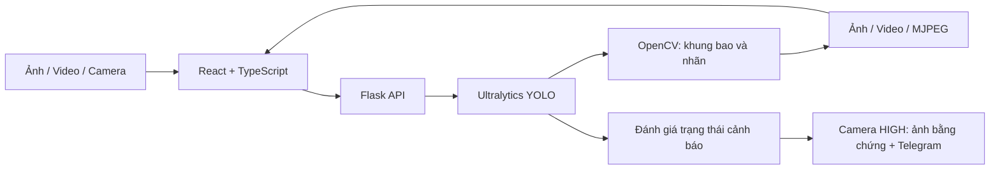

<div align="center">

# ExamGuard

**Phone Usage Detection for Exam Monitoring**

Hệ thống hỗ trợ giám sát thi bằng thị giác máy tính: phát hiện điện thoại và hành vi sử dụng điện thoại từ ảnh, video và camera trực tiếp.


**YOLO Object Detection · OpenCV · MJPEG Streaming · Telegram Alerts**

</div>

---

## Mục lục

- [Tổng quan](#tổng-quan)
- [Kiến trúc](#kiến-trúc)
- [Cài đặt và khởi chạy](#cài-đặt-và-khởi-chạy)
- [Mô hình và nhãn phát hiện](#mô-hình-và-nhãn-phát-hiện)
- [Camera và cảnh báo](#camera-và-cảnh-báo)
- [Cấu hình](#cấu-hình)
- [API](#api)
- [Cấu trúc thư mục](#cấu-trúc-thư-mục)
- [Kiểm thử](#kiểm-thử)
- [Repository GitHub](#repository-github)
- [Giới hạn và giấy phép](#giới-hạn-và-giấy-phép)

## Tổng quan

ExamGuard cung cấp một giao diện web thống nhất để giám thị xem xét kết quả phát hiện, gồm khung bao đối tượng (*bounding box*), nhãn và độ tin cậy (*confidence score*). Backend sử dụng Ultralytics YOLO để suy luận, OpenCV để xử lý hình ảnh và Flask để cung cấp API cùng luồng camera.

| Chức năng | Mô tả |
| --- | --- |
| Phân tích ảnh | Nhận ảnh JPEG/PNG, trả ảnh có khung bao và danh sách phát hiện. |
| Phân tích video | Nhận MP4/AVI/MOV, suy luận theo chu kỳ và xuất video có chú thích. |
| Camera trực tiếp | Hỗ trợ webcam của máy chạy backend và luồng MJPEG từ điện thoại trong mạng LAN. |
| Lựa chọn mô hình | Chuyển giữa mô hình phát hiện `phone` + `using_phone` và mô hình COCO chỉ phát hiện điện thoại. |
| Cảnh báo theo thời gian | Hiển thị trạng thái `NORMAL`, `LOW`, `HIGH` trên video và camera. |
| Thông báo Telegram | Với camera trực tiếp, lưu ảnh bằng chứng và gửi cảnh báo khi đạt mức `HIGH`, có khoảng chờ giữa các lần gửi. |

> Kết quả là tín hiệu hỗ trợ giám sát. Người phụ trách cần kiểm tra bằng chứng và bối cảnh trước khi đưa ra kết luận về một trường hợp cụ thể.

## Kiến trúc



- **Frontend:** React 18, TypeScript, Vite, Tailwind CSS, Framer Motion và Lucide React.
- **Backend:** Flask, NumPy, OpenCV; inference chạy qua Ultralytics/PyTorch.
- **Mã hóa video:** ưu tiên H.264/MP4 bằng `imageio-ffmpeg`; dùng VP8/WebM khi thư viện này không có và hệ thống hỗ trợ codec tương ứng.
- **Camera:** tách thu nhận khung hình, suy luận và gửi cảnh báo; ưu tiên khung hình mới nhất để hạn chế tồn đọng.
- **Lưu trữ:** file cục bộ trong `uploads/`, `outputs/`, `alerts/`; ứng dụng tự tạo các thư mục này khi khởi động.

## Cài đặt và khởi chạy

### 1. Chuẩn bị môi trường

Môi trường được dùng để kiểm tra bản đóng gói: **Python 3.13**, **Node.js 24** và **npm 11**. Máy chủ cần có quyền ghi vào thư mục dự án; webcam hoặc camera điện thoại chỉ cần khi sử dụng chế độ camera.

Lấy mã nguồn cùng hai checkpoint đi kèm:

```bash
git clone https://github.com/VPhunggggg/examguard-phone-detection.git
cd examguard-phone-detection
```

Mở terminal tại thư mục dự án và tạo môi trường Python riêng:

```bash
python -m venv .venv
```

**Windows PowerShell:**

```powershell
.\.venv\Scripts\Activate.ps1
```

**Linux / macOS:**

```bash
source .venv/bin/activate
```

Cài thư viện backend và frontend:

```bash
python -m pip install -r requirements.txt
npm ci
```

`requirements.txt` ghi lại phiên bản các thư viện backend trực tiếp đang có trong môi trường dự án. PyTorch và các phụ thuộc bắc cầu được trình cài đặt giải quyết theo yêu cầu của Ultralytics; đây chưa phải lockfile cho toàn bộ môi trường Python. GPU không bắt buộc.

### 2. Tạo cấu hình cục bộ

**Windows PowerShell:**

```powershell
Copy-Item .env.example .env
```

**Linux / macOS:**

```bash
cp .env.example .env
```

Thực hiện bước này khi chưa có `.env`; giữ lại cấu hình hiện có nếu bạn đang cập nhật dự án. Mặc định trong `.env.example`, Telegram được tắt. Nếu `ADMIN_API_TOKEN` để trống, ứng dụng sẽ sinh token và lưu khi khởi động.

### 3. Kiểm tra trọng số mô hình

```text
models/
├── yolo11n_merged_behavior_dts_p2_noaug_best.pt
└── yolov8n.pt
```

Bản ZIP và repository đều kèm hai checkpoint này. `.gitignore` giữ riêng chúng trong Git, đồng thời bỏ qua các file `.pt` khác. Có thể dùng trọng số đặt ở vị trí khác bằng các biến đường dẫn trong [phần cấu hình](#cấu-hình).

Ứng dụng không tự tải checkpoint bị thiếu. Từng mô hình được kiểm tra độc lập; khi thiếu trọng số của mô hình đã chọn, API trả `503 detector_unavailable`.

### 4. Dựng giao diện và chạy backend

```bash
npm run build
python app.py
```

Mở **[http://127.0.0.1:5000](http://127.0.0.1:5000)**.

| Đường dẫn | Chức năng |
| --- | --- |
| `/` | Trang giới thiệu và truy cập các công cụ |
| `/image` | Phân tích ảnh |
| `/video` | Phân tích video |
| `/camera` | Giám sát camera trực tiếp |

Trên Windows, sau khi cài thư viện và dựng giao diện, có thể khởi động bằng `run_local_server.cmd` trong terminal đã kích hoạt môi trường Python.

### Phát triển frontend

Giữ Flask chạy ở cổng `5000`, sau đó mở terminal thứ hai:

```bash
npm run dev
```

Truy cập địa chỉ Vite in trong terminal. Vite proxy `/api`, `/media` và `/video_feed` về Flask. Sau khi sửa giao diện, chạy lại `npm run build` để Flask phục vụ bản mới trong `static/landing/`.

## Mô hình và nhãn phát hiện

| Mô hình | Giá trị API | Checkpoint mặc định | Nhãn trả về |
| --- | --- | --- | --- |
| **Phone + Using Phone** — mặc định | `yolo11n_behavior_p2` | `models/yolo11n_merged_behavior_dts_p2_noaug_best.pt` | `phone`, `using_phone` |
| **Phone** — YOLOv8n COCO | `yolov8n_coco_phone` | `models/yolov8n.pt` | `phone` |

API và giao diện dùng chung hai ID lớp công khai:

| ID công khai | Nhãn | Hiển thị |
| --- | --- | --- |
| `1` | `phone` | Điện thoại |
| `7` | `using_phone` | Đang sử dụng điện thoại |

Mô hình mặc định sử dụng trực tiếp lớp `1` và `7` của checkpoint. Với YOLOv8n COCO, lớp gốc `67 = cell phone` được ánh xạ thành lớp công khai `1 = phone`; mô hình này không trả về lớp `using_phone`.

Cả hai nhãn công khai đều được tính là có phát hiện điện thoại khi đánh giá trạng thái cảnh báo. Ngưỡng confidence mặc định là `0.5`, có thể điều chỉnh trong khoảng `0.1–0.9`. Confidence là điểm tin cậy của từng dự đoán, không phải độ chính xác tổng thể của mô hình.

## Camera và cảnh báo

### Kết nối nguồn hình

- **Webcam:** chọn camera có chỉ số `0–9` trên máy đang chạy Flask.
- **Camera điện thoại:** cho điện thoại và máy chủ vào cùng mạng LAN, bật ứng dụng phát MJPEG và nhập địa chỉ, ví dụ `http://192.168.1.20:8080`. Khi URL chỉ có địa chỉ máy chủ, ứng dụng tự thêm `/video`.

Camera điện thoại chấp nhận URL HTTP/HTTPS có địa chỉ IPv4 riêng thuộc `10.0.0.0/8`, `172.16.0.0/12` hoặc `192.168.0.0/16`. URL chứa tài khoản/mật khẩu, hostname, RTSP và địa chỉ Internet công khai không được hỗ trợ.

### Trạng thái cảnh báo

| Trạng thái | Điều kiện |
| --- | --- |
| `NORMAL` | Không có phát hiện điện thoại trong kết quả đang xét. |
| `LOW` | Có phát hiện nhưng chưa đủ khoảng thời gian cảnh báo. |
| `HIGH` | Phát hiện được duy trì liên tục trong khoảng 2 giây. |

Video tải lên tính thời gian theo FPS của video. Camera trực tiếp sử dụng thời điểm hoàn thành các lượt suy luận. Trạng thái được đánh giá cho luồng hình ảnh, chưa gắn với danh tính hay hồ sơ riêng của từng thí sinh.

Với camera trực tiếp, mức `HIGH` kích hoạt lưu frame vào `alerts/` và gửi Telegram nếu đã cấu hình. Thời gian chờ mặc định là **30 giây**, áp dụng cả cho bước lưu ảnh và gửi thông báo. Video tải lên chỉ hiển thị trạng thái trên kết quả video.

### Bật thông báo Telegram

Điền các giá trị sau trong `.env`:

```dotenv
TELEGRAM_ENABLED=true
TELEGRAM_BOT_TOKEN=your_telegram_bot_token
TELEGRAM_CHAT_ID=
TELEGRAM_AUTO_POLLING=true
ALERT_COOLDOWN_SECONDS=30
```

Có thể điền trực tiếp `TELEGRAM_CHAT_ID` hoặc gửi `/start` cho bot để ứng dụng cập nhật chat ID qua polling. Giới hạn người đăng ký bằng `TELEGRAM_ALLOWED_USER_IDS` hoặc yêu cầu mã đăng ký bằng `TELEGRAM_REGISTRATION_CODE` khi cần.

Chạy `python app.py` sẽ khởi động vòng polling nền. Khi import ứng dụng qua máy chủ WSGI, đặt `START_TELEGRAM_POLLING=true` nếu muốn bật polling ở tiến trình đó.

Các route quản trị như `/telegram_status`, `/telegram_poll_once` và `/test_telegram` yêu cầu header `X-Admin-Token`. Đọc token đã cấu hình hoặc được sinh trong file trạng thái; không đưa token vào URL hay README.

## Cấu hình

Danh sách mẫu nằm trong [`.env.example`](.env.example).

| Biến | Mặc định trong `.env.example` | Ý nghĩa |
| --- | --- | --- |
| `YOLO11N_BEHAVIOR_P2_MODEL_PATH` | Trống | Ghi đè đường dẫn checkpoint mặc định. |
| `YOLOV8N_COCO_PHONE_MODEL_PATH` | Trống | Ghi đè đường dẫn checkpoint YOLOv8n. |
| `APP_MAX_UPLOAD_MB` | `200` | Giới hạn dung lượng toàn bộ request upload, tính theo MiB. |
| `CAMERA_PHONE_INFERENCE_FPS` | `10` | Tần suất suy luận mục tiêu cho camera. |
| `CAMERA_PHONE_OUTPUT_FPS` | `24` | Tần suất xuất luồng camera mục tiêu. |
| `CAMERA_PHONE_JPEG_QUALITY` | `70` | Chất lượng JPEG cho luồng MJPEG. |
| `CAMERA_OUTPUT_MAX_EDGE` | `960` | Cạnh dài tối đa của khung hình camera, theo pixel. |
| `VIDEO_PHONE_INFERENCE_FPS` | `5` | Tần suất suy luận mục tiêu khi xử lý video. |
| `VIDEO_MAX_OUTPUT_EDGE` | `1280` | Cạnh dài tối đa của video kết quả, theo pixel. |
| `VIDEO_ENCODER_THREADS` | `2` | Số luồng dùng cho bộ mã hóa video. |
| `YOLO_CPU_THREADS` | `8` | Giới hạn luồng PyTorch trên CPU; `0` giữ mặc định PyTorch. |
| `ALERT_COOLDOWN_SECONDS` | `30` | Khoảng chờ giữa các lần lưu bằng chứng/gửi cảnh báo camera. |
| `APP_STATE_DIR` | Trống | Chuyển trạng thái runtime sang `telegram_runtime.env` trong thư mục được chỉ định. |
| `ADMIN_API_TOKEN` | Trống | Token bảo vệ route quản trị; tự sinh nếu chưa có. |

`APP_HOST` và `PORT` là biến môi trường được backend hỗ trợ, mặc định lần lượt là `127.0.0.1` và `5000`. Script Windows `run_local_server.cmd` đặt cố định hai giá trị này cho phiên chạy local.

`APP_STATE_DIR` cần được đặt trong môi trường tiến trình trước khi khởi chạy vì đường dẫn trạng thái được xác định trước bước đọc `.env`.

Các giá trị FPS trên là mục tiêu cấu hình, không phải cam kết hiệu năng. Tốc độ thực tế phụ thuộc phần cứng, độ phân giải, mô hình và chất lượng kết nối camera.

## API

| Phương thức | Endpoint | Dữ liệu / kết quả chính |
| --- | --- | --- |
| `GET` | `/api/config` | Mô hình, ngưỡng confidence, trạng thái có checkpoint và quy tắc upload. |
| `POST` | `/api/image` | Multipart: `image_file`; trả URL ảnh gốc, ảnh kết quả và `detections`. |
| `POST` | `/api/video` | Multipart: `video_file`; trả URL video gốc và video kết quả. |
| `POST` | `/api/camera/connect` | JSON nguồn camera; trả `connection_id` và `feed_url`. |
| `DELETE` | `/api/camera/connections/<connection_id>` | Giải phóng kết nối camera. |
| `GET` | `/video_feed` | Luồng MJPEG; sử dụng `feed_url` do API kết nối trả về. |
| `GET` | `/media/uploads/<filename>` | Đọc file đầu vào đã được lưu. |
| `GET` | `/media/outputs/<filename>` | Đọc file kết quả đã được lưu. |

Ảnh và video nhận thêm `model_mode`, `conf_threshold` qua multipart form. API kết nối camera nhận hai giá trị này trong JSON.

Ví dụ phân tích ảnh bằng `curl` trong Bash; trên Windows PowerShell dùng `curl.exe`:

```bash
curl -X POST http://127.0.0.1:5000/api/image \
  -F "image_file=@/path/to/exam-frame.jpg" \
  -F "model_mode=yolo11n_behavior_p2" \
  -F "conf_threshold=0.5"
```

Video được xử lý đồng bộ. Khi một video khác đang được xử lý, API trả `409 video_busy`. Các request upload không hợp lệ trả `400 invalid_upload`; lỗi xử lý media trả `422 processing_failed`. Frontend và client cần xử lý cả lỗi JSON lẫn thời gian chờ khi video dài.

## Cấu trúc thư mục

```text
examguard-phone-detection/
├── app.py                      # Flask API, camera streaming và điều phối xử lý
├── requirements.txt            # Thư viện Python trực tiếp
├── package.json                # Thư viện và script frontend
├── package-lock.json           # Lockfile npm
├── .env.example                # Cấu hình mẫu, không chứa thông tin xác thực thật
├── models/                     # Checkpoint YOLO
├── src/
│   ├── api/                    # Client và kiểu dữ liệu API
│   ├── assets/                 # Tài nguyên giao diện
│   ├── components/             # Thành phần React dùng chung
│   ├── hooks/                  # React hooks
│   ├── pages/                  # Landing, ảnh, video và camera
│   └── styles/                 # Styles và design tokens
├── static/
│   ├── assets/                 # Tài nguyên tĩnh
│   ├── images/                 # Hình ảnh giao diện
│   └── landing/                # Giao diện được dựng bởi Vite
├── utils/
│   ├── detector.py             # Nạp mô hình, suy luận và ánh xạ nhãn
│   ├── alert_logic.py          # Trạng thái cảnh báo theo thời gian
│   └── telegram_notifier.py    # Telegram và trạng thái cấu hình
├── tests/                      # Kiểm thử API, camera, detector và bảo mật
├── DESIGN.md                   # Tài liệu thiết kế giao diện
├── PRODUCT.md                  # Mục tiêu và nguyên tắc sản phẩm
└── run_local_server.cmd        # Khởi chạy local trên Windows
```

`uploads/`, `outputs/`, `alerts/`, môi trường Python, log và cache là dữ liệu phát sinh; chúng không thuộc bản mã nguồn sạch. Giữ `static/landing/` trong bản đóng gói nếu muốn Flask có sẵn giao diện trước khi dựng lại.

## Kiểm thử

Sau khi cài đủ thư viện, chạy tại thư mục gốc:

```bash
npm run typecheck
npm test
npm run build
python -B -m unittest discover -s tests -v
```

Kiểm thử frontend dùng Vitest và React Testing Library; backend dùng `unittest`. Nhiều tình huống camera, detector và Telegram được mô phỏng trong test. Các test này không thay thế kiểm tra camera vật lý, chất lượng phát hiện trên dữ liệu thực tế hoặc khả năng gửi thông báo tới bot đã cấu hình.

Backend có thể sinh token và ghi file trạng thái khi được import; dùng cấu hình thử nghiệm riêng khi chạy kiểm thử.

## Repository GitHub

[VPhunggggg/examguard-phone-detection](https://github.com/VPhunggggg/examguard-phone-detection) chứa mã nguồn backend/frontend, tài liệu, `.env.example`, lockfile, giao diện dựng sẵn trong `static/landing/` và hai checkpoint trong `models/`.

Các file `.env`, cấu hình Telegram runtime, media cá nhân, log, cache, môi trường ảo và `node_modules/` được loại khỏi Git. Giữ cấu hình riêng trên máy chạy ứng dụng.

## Giới hạn và giấy phép

- Nhận diện chịu ảnh hưởng của góc quay, che khuất, ánh sáng, kích thước điện thoại và khác biệt dữ liệu. Có thể xuất hiện phát hiện nhầm hoặc bỏ sót.
- Repository chưa kèm báo cáo đánh giá precision, recall, mAP hoặc benchmark FPS có quy trình tái lập; không suy ra các chỉ số này từ confidence hay thông số cấu hình.
- Phiên bản hiện tại chưa cung cấp quản lý tài khoản giám thị, cơ sở dữ liệu phiên thi, nhận dạng danh tính hay thống kê theo từng thí sinh.
- Upload có kiểm tra phần mở rộng, MIME, chữ ký file và giới hạn dung lượng. Token quản trị bảo vệ các route quản trị; các route phân tích và media chưa có cơ chế đăng nhập người dùng. Cấu hình chạy mặc định dành cho máy local.
- Dự án hiện chưa có file `LICENSE` riêng. Cần xác định giấy phép cho mã nguồn và quyền phân phối từng checkpoint trước khi công bố; các thư viện phụ thuộc vẫn chịu giấy phép của chính chúng.
