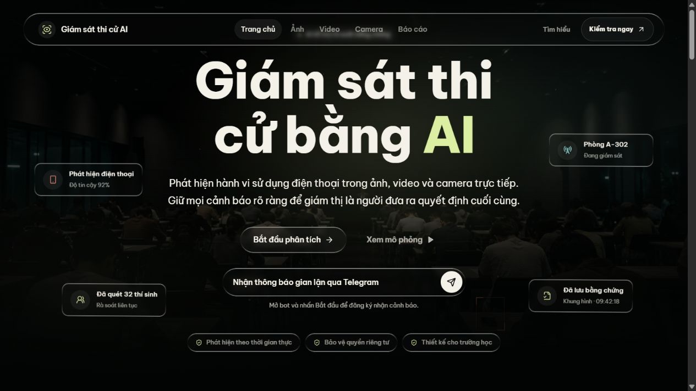
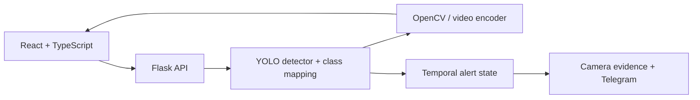
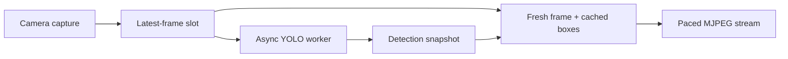

<div align="center">

# ExamGuard

### Detect phone use. Preserve evidence. Support human review.

Ứng dụng thị giác máy tính hỗ trợ giám sát thi qua ảnh, video và camera trực tiếp.

   

[Kiến trúc](#kiến-trúc) · [Camera pipeline](#camera-pipeline) · [Chạy dự án](#chạy-dự-án) · [API](#api) · [Kiểm chứng](#kiểm-chứng-và-phạm-vi)

</div>



<p align="center"><sub>Ảnh chụp giao diện thực tế từ mã nguồn. Các thẻ 92%, phòng thi và số thí sinh trên trang giới thiệu là dữ liệu minh họa giao diện.</sub></p>

## Bài toán

Một dự đoán phát hiện điện thoại chỉ là điểm khởi đầu. ExamGuard kết nối **suy luận, hiển thị bằng chứng và cảnh báo theo thời gian** trong cùng một ứng dụng: người dùng chọn nguồn hình, xem bounding box và confidence, rồi rà soát ngữ cảnh trước khi đưa ra kết luận.

| Luồng sử dụng | Kết quả |
| --- | --- |
| Phân tích ảnh | Ảnh gốc, ảnh có chú thích và bảng detection gồm nhãn, confidence, tọa độ. |
| Phân tích video | Video có bounding box và trạng thái cảnh báo; suy luận lấy mẫu, tái sử dụng detection giữa các lần chạy model. |
| Camera trực tiếp | Webcam trên máy backend hoặc MJPEG từ điện thoại trong LAN; điều chỉnh model và confidence. |
| Cảnh báo camera | Trạng thái `NORMAL` / `LOW` / `HIGH`, lưu ảnh bằng chứng và gửi Telegram khi được cấu hình. |

## Kiến trúc



| Quyết định kỹ thuật | Ý nghĩa |
| --- | --- |
| API contract có kiểu dữ liệu ở frontend | Chuẩn hóa settings, detections, camera connection và lỗi trong [src/api/client.ts](src/api/client.ts). |
| Detector cache theo model, checkpoint và confidence | Tái sử dụng detector cùng cấu hình; khóa suy luận bảo vệ mỗi instance khi nhiều request truy cập. |
| Ưu tiên camera trong khóa suy luận | Lượt camera đang chờ được xét trước lượt xử lý ảnh/video đang xếp hàng trên cùng detector. |
| Kiểm tra metadata checkpoint và ánh xạ lớp | Xác minh nhãn gốc, thống nhất ID công khai giữa hai model; trạng thái thiếu model được báo riêng. |
| Camera session có connection ID và stream token | Kiểm tra nguồn trước khi cấp luồng, cho luồng mới thay thế luồng cũ và giải phóng kết nối khi rời trang. |
| Upload được kiểm tra ở backend | Kiểm tra phần mở rộng, MIME, chữ ký file và giới hạn request; trả lỗi JSON có mã để UI xử lý. |
| Xử lý video có khóa riêng | Một video được xử lý tại mỗi thời điểm trong một tiến trình; request đồng thời nhận `409 video_busy`. |

Đọc triển khai: [điều phối Flask](app.py), [detector và khóa ưu tiên](utils/detector.py), [trạng thái cảnh báo video](utils/alert_logic.py), [Telegram và trạng thái runtime](utils/telegram_notifier.py).

## Camera pipeline



- **Giữ khung hình mới nhất:** capture và inference có slot thay thế được, tránh tích lũy hàng đợi khi model xử lý chậm.
- **Tách suy luận khỏi streaming:** luồng hiển thị lấy snapshot detection gần nhất, vẽ lên frame mới và mã hóa JPEG theo nhịp riêng. Bounding box có thể trễ so với hình hiện tại khi đối tượng di chuyển nhanh.
- **Hủy công việc đã lỗi thời:** kiểm tra generation và trạng thái dừng trước khi chạy model sau thời gian chờ khóa. Lời gọi model đang thực thi vẫn có thể chạy đến hết.
- **Tách I/O cảnh báo:** `BoundedAlertDispatcher` giữ tối đa một frame chờ, đưa việc ghi bằng chứng/gửi Telegram ra khỏi vòng xuất MJPEG.

### Trạng thái theo thời gian

| Trạng thái | Điều kiện |
| --- | --- |
| `NORMAL` | Kết quả suy luận đang xét không phát hiện điện thoại. |
| `LOW` | Có phát hiện nhưng chưa đủ khoảng thời gian cảnh báo. |
| `HIGH` | Chuỗi kết quả có phát hiện đạt ngưỡng khoảng 2 giây. |

Camera tính khoảng thời gian qua timestamp đơn điệu của **các lần suy luận hoàn tất**. Video tải lên tính theo số frame và FPS nguồn, bao gồm frame dùng detection đã cache. Cả `phone` và `using_phone` đều kích hoạt logic này. Trạng thái áp dụng cho luồng hình, chưa theo dõi riêng từng thí sinh.

Với camera, `HIGH` kích hoạt lưu ảnh vào `alerts/`; gửi Telegram khi đã bật và có đủ thông tin bot/chat. Cooldown mặc định **30 giây** áp dụng cho cả bước lưu ảnh và gửi thông báo. Video tải lên chỉ hiển thị trạng thái trên video kết quả.

## Mô hình và nhãn

Hai checkpoint được giữ trong [models/](models/); ứng dụng không tự tải model bị thiếu.

| Chế độ | Giá trị `model_mode` | Checkpoint | Nhãn công khai |
| --- | --- | --- | --- |
| Phone + Using Phone — mặc định | `yolo11n_behavior_p2` | `yolo11n_merged_behavior_dts_p2_noaug_best.pt` | `1: phone`, `7: using_phone` |
| Phone — YOLOv8n COCO | `yolov8n_coco_phone` | `yolov8n.pt` | `1: phone` |

Model mặc định dùng lớp gốc `1` và `7`. Chế độ COCO chỉ trả nhãn `phone`. Confidence mặc định `0.5`, điều chỉnh trong khoảng `0.1–0.9`; đây là điểm của từng dự đoán, không phải chỉ số accuracy của hệ thống.

## Chạy dự án

**Môi trường đã dùng cho bản đóng gói:** Python 3.13, Node.js 24 và npm 11. Backend dùng Flask, OpenCV, NumPy, Ultralytics/PyTorch; frontend dùng React 18, TypeScript, Vite, Tailwind CSS và Framer Motion. GPU không bắt buộc.

### Windows PowerShell

```powershell
git clone https://github.com/VPhunggggg/examguard-phone-detection.git
cd examguard-phone-detection
py -3.13 -m venv .venv
.\.venv\Scripts\python.exe -m pip install -r requirements.txt
npm ci
Copy-Item .env.example .env
npm run build
.\.venv\Scripts\python.exe app.py
```

Tạo `.env` khi cài mới; giữ cấu hình hiện có khi cập nhật. Mở **[http://127.0.0.1:5000](http://127.0.0.1:5000)**. Các công cụ nằm tại `/image`, `/video`, `/camera`. Mặc định Telegram tắt; admin token được sinh và lưu nếu chưa có.

<details>
<summary>Linux / macOS</summary>

```bash
git clone https://github.com/VPhunggggg/examguard-phone-detection.git
cd examguard-phone-detection
python3 -m venv .venv
source .venv/bin/activate
python -m pip install -r requirements.txt
npm ci
cp .env.example .env
npm run build
python app.py
```

</details>

`npm run build` ghi frontend vào `static/landing/` để Flask phục vụ cùng origin. Khi phát triển, giữ Flask ở cổng `5000`, chạy `npm run dev` trong terminal khác; Vite proxy `/api`, `/media`, `/video_feed` về backend. Sau khi sửa UI, build lại để Flask phục vụ bản mới.

`package-lock.json` khóa dependency frontend. [requirements.txt](requirements.txt) ghim thư viện Python trực tiếp; PyTorch và phụ thuộc bắc cầu vẫn được resolver chọn, nên chưa tái lập toàn bộ môi trường Python bằng lockfile.

### Kết nối camera và Telegram

1. Chọn webcam có chỉ số `0–9` trên **máy chạy Flask**, hoặc nguồn điện thoại phát MJPEG trong cùng LAN.
2. Với điện thoại, nhập URL như `http://192.168.1.20:8080`; ứng dụng thêm `/video` nếu URL chưa có path.
3. Chọn model và confidence, kết nối rồi kiểm tra luồng hình trước khi sử dụng cảnh báo.

Nguồn điện thoại chấp nhận HTTP/HTTPS với IPv4 riêng thuộc `10.0.0.0/8`, `172.16.0.0/12`, `192.168.0.0/16`. Hostname, URL chứa thông tin đăng nhập, RTSP và IP Internet công khai chưa được hỗ trợ.

Để bật Telegram, cập nhật `.env` với thông tin bot của bạn:

```dotenv
TELEGRAM_ENABLED=true
TELEGRAM_BOT_TOKEN=<BOT_TOKEN>
TELEGRAM_CHAT_ID=<CHAT_ID>
ALERT_COOLDOWN_SECONDS=30
```

Có thể để trống chat ID, bật `TELEGRAM_AUTO_POLLING=true` và gửi `/start` cho bot. `TELEGRAM_ALLOWED_USER_IDS` và `TELEGRAM_REGISTRATION_CODE` giới hạn đăng ký. Khi chạy `python app.py`, polling khởi động ở nền; với WSGI, chỉ bật ở tiến trình được chọn bằng `START_TELEGRAM_POLLING=true`.

Các route quản trị như `/telegram_status`, `/telegram_poll_once`, `/test_telegram` yêu cầu header `X-Admin-Token`. Giữ bot token, admin token và trạng thái runtime trong cấu hình cục bộ.

## Cấu hình vận hành

Danh sách đầy đủ tại [.env.example](.env.example). Các giá trị dưới đây là mặc định trong file mẫu:

| Biến | Giá trị | Mục đích |
| --- | ---: | --- |
| `APP_MAX_UPLOAD_MB` | `200` | Giới hạn toàn bộ request upload, tính theo MiB. |
| `CAMERA_PHONE_INFERENCE_FPS` | `10` | Nhịp suy luận camera mục tiêu. |
| `CAMERA_PHONE_OUTPUT_FPS` | `24` | Nhịp xuất MJPEG mục tiêu, độc lập với nhịp suy luận. |
| `CAMERA_PHONE_JPEG_QUALITY` | `70` | Chất lượng JPEG streaming. |
| `CAMERA_OUTPUT_MAX_EDGE` | `960` | Cạnh dài tối đa của frame camera, theo pixel. |
| `VIDEO_PHONE_INFERENCE_FPS` | `5` | Nhịp lấy mẫu suy luận video mục tiêu. |
| `VIDEO_MAX_OUTPUT_EDGE` | `1280` | Cạnh dài tối đa của video kết quả. |
| `VIDEO_ENCODER_THREADS` | `2` | Số luồng bộ mã hóa video. |
| `YOLO_CPU_THREADS` | `8` | Giới hạn luồng PyTorch trên CPU; `0` giữ mặc định. |
| `ALERT_COOLDOWN_SECONDS` | `30` | Khoảng chờ giữa các lần lưu bằng chứng/gửi cảnh báo. |

Các biến `YOLO11N_BEHAVIOR_P2_MODEL_PATH`, `YOLOV8N_COCO_PHONE_MODEL_PATH` ghi đè checkpoint. `APP_HOST` / `PORT` mặc định `127.0.0.1` / `5000`; launcher Windows [run_local_server.cmd](run_local_server.cmd) đặt cố định hai giá trị này cho phiên local.

Đặt `APP_STATE_DIR` trong môi trường tiến trình **trước khi chạy** nếu muốn lưu `telegram_runtime.env` ở thư mục riêng; đường dẫn này được xác định trước khi đọc `.env`. Thư mục cần có quyền ghi.

FPS là mục tiêu điều phối, chưa phải benchmark. Video ưu tiên H.264/MP4 qua `imageio-ffmpeg`, có đường dự phòng VP8/WebM khi encoder tương ứng khả dụng. Chất lượng, độ trễ và tốc độ thực phụ thuộc model, phần cứng, codec và nguồn camera.

## API

| Phương thức | Endpoint | Contract chính |
| --- | --- | --- |
| `GET` | `/api/config` | Model options, checkpoint availability, confidence và quy tắc upload. |
| `POST` | `/api/image` | Multipart `image_file`; trả `original_url`, `output_url`, `detections`, `settings`. |
| `POST` | `/api/video` | Multipart `video_file`; trả `input_url`, `output_url`, `settings` sau khi xử lý xong. |
| `POST` | `/api/camera/connect` | JSON nguồn camera + settings; trả `connection_id`, `feed_url`. |
| `DELETE` | `/api/camera/connections/<connection_id>` | Giải phóng camera session. |
| `GET` | `/video_feed` | MJPEG; sử dụng `feed_url` do API kết nối trả về. |
| `GET` | `/media/uploads/<filename>` / `/media/outputs/<filename>` | Đọc media đầu vào/kết quả đã lưu. |

Ảnh/video nhận thêm `model_mode`, `conf_threshold` qua multipart; camera nhận hai trường này trong JSON. Upload ảnh hỗ trợ JPEG/PNG; video hỗ trợ MP4/AVI/MOV.

Ví dụ bằng `curl.exe` trên PowerShell:

```powershell
curl.exe -X POST http://127.0.0.1:5000/api/image -F "image_file=@exam-frame.jpg" -F "model_mode=yolo11n_behavior_p2" -F "conf_threshold=0.5"
```

Lỗi được trả dưới dạng `{ "ok": false, "error": { "code": "...", "message": "..." } }`. Các trường hợp chính: `400 invalid_upload`, `409 video_busy`, `413 file_too_large`, `422 processing_failed`, `429 rate_limited`, `503 detector_unavailable`.

Video xử lý **đồng bộ**; đóng hoặc refresh trình duyệt không hủy request đang chạy. Client cần chờ kết quả hoặc xử lý timeout, tránh gửi lặp một tác vụ dài.

## Bản đồ mã nguồn

```text
app.py                      Flask routes, camera workers, media và điều phối
utils/detector.py           Model loading, class mapping, inference lock
utils/alert_logic.py        Trạng thái cảnh báo theo frame cho video
utils/telegram_notifier.py  Gửi thông báo, đăng ký chat và trạng thái runtime
src/api/                   Typed API client, kiểm tra upload, chuẩn hóa lỗi
src/pages/                 Landing, image, video, camera
src/components/            UI, detector settings, media và detection table
static/landing/            Frontend build do Flask phục vụ
models/                    Hai checkpoint đi kèm
tests/                     Backend API, streaming, concurrency và bảo mật
```

`uploads/`, `outputs/`, `alerts/`, `.env`, runtime state, cache và môi trường cục bộ được loại khỏi Git. Media được lưu trên máy backend; cần quản lý thời gian lưu và dung lượng khi vận hành. Tài liệu thiết kế giao diện tại [DESIGN.md](DESIGN.md), định hướng sản phẩm tại [PRODUCT.md](PRODUCT.md).

## Kiểm chứng và phạm vi

```powershell
npm run typecheck
npm test
npm run build
.\.venv\Scripts\python.exe -B -m unittest discover -s tests -v
```

Bộ kiểm thử hiện có bao phủ API contract, ánh xạ nhãn, lỗi upload, session lifecycle, latest-frame workers, ưu tiên suy luận camera, cooldown, kết nối lại và xử lý lỗi trên UI. Nhiều tình huống dùng camera/detector/Telegram giả lập. Khi chạy test, dùng cấu hình riêng vì backend có thể sinh token và ghi trạng thái khi import.

- **Độ chính xác:** chưa kèm benchmark precision, recall, mAP hoặc FPS có quy trình tái lập; cần đánh giá trên dữ liệu đúng góc camera và điều kiện phòng thi.
- **Triển khai:** cấu hình mặc định dành cho local. Route phân tích và media chưa có đăng nhập người dùng; token quản trị chỉ bảo vệ nhóm route quản trị. Session, cache và khóa nằm trong từng tiến trình.
- **Phạm vi sản phẩm:** chưa có nhận dạng danh tính, cơ sở dữ liệu phiên thi hoặc thống kê từng thí sinh. Cảnh báo là tín hiệu cần người phụ trách xem xét.
- **Kiểm tra thực địa:** test tự động chưa xác nhận camera vật lý, Telegram thật hay vận hành dài ngày. Phụ thuộc mạng, codec và thời gian model chạy vẫn ảnh hưởng trải nghiệm.
- **Giấy phép:** repo chưa có `LICENSE` riêng; quyền sử dụng mã, tài nguyên và checkpoint cần được xác định theo từng thành phần.
